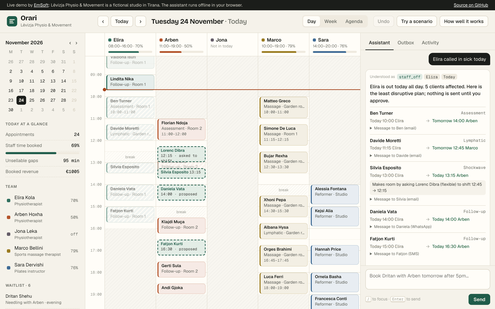
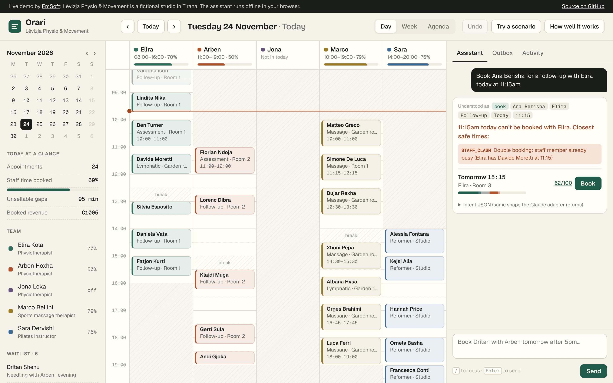
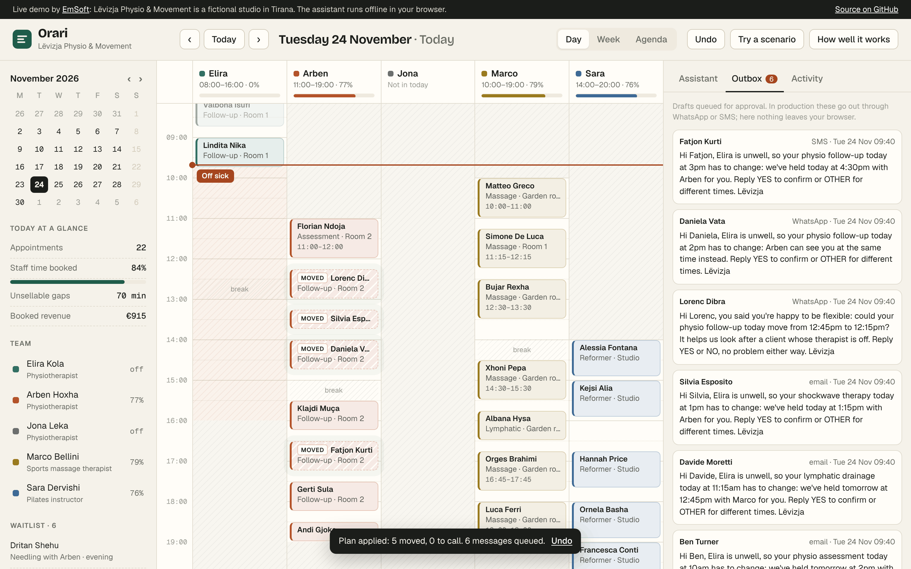
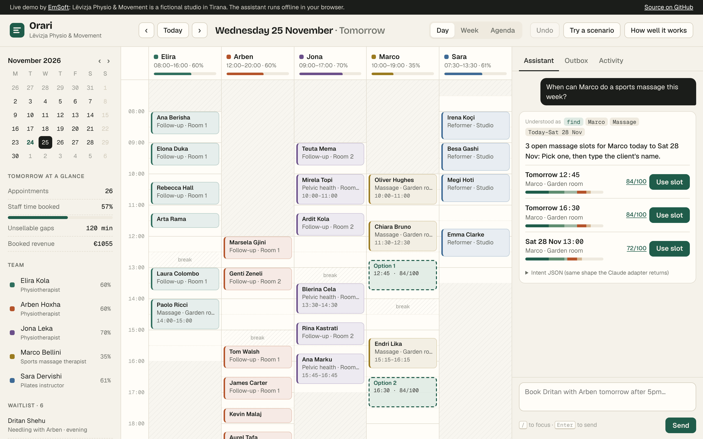

# AI booking calendar: book, move and rescue a sick day in plain words

Appointment businesses lose hours to the phone-and-diary shuffle: finding a slot that suits the client, the therapist and the room, and redoing a whole day when someone calls in sick. Orari lets the front desk type what needs to happen ("Arben called in sick today"), proposes the least disruptive change, drafts the messages to clients, and refuses anything unsafe, like a double booking, in code.

**▶ Live demo: https://enxo7899.github.io/ai-booking-calendar/** (click **Try a scenario → A therapist calls in sick**, then **Approve plan**)



Live demo by EmSoft: Lëvizja Physio & Movement is a fictional physiotherapy and pilates studio in Tirana. Every name and booking was written for the demo.

## What it does

| Capability | Detail |
|---|---|
| Plain-language requests | "Book Dritan for dry needling with Arben tomorrow after 5pm", "push Tom back an hour", "Ana needs a follow-up tomorrow morning". English, plus common Albanian and Italian phrasing ("Rezervo Besa për pilates nesër në 10"). |
| Ranked slots, with reasons | Every suggestion is scored on the client's usual therapist, their preferred time of day, how soon it is, whether it leaves an unsellable gap, and staff load. Click the score to see the breakdown. |
| One-click sick-day rescue | Marks the absence and plans new slots for every affected client at once, keeping people with their usual therapist where possible. Flexible clients can be asked to shift 15 to 90 minutes so someone else keeps their day. |
| Preview before anything changes | Proposals appear on the calendar as dashed outlines, and the appointments that would move are struck through. Nothing is saved until a person presses Confirm. |
| Drafted client messages | Each move comes with a WhatsApp/SMS/email draft in the Outbox, with "Reply YES to confirm". Moved bookings stay marked *awaiting reply*. |
| Waitlist that fills gaps | A cancellation immediately shows who on the waitlist fits the freed time. "Fill the gaps tomorrow" offers every short gap to people waiting. |
| Day, week and agenda views | Staff columns with shifts, breaks and absences; drag a booking to move it (the ghost turns red and says why if the move is unsafe). Works on a phone. |
| Undo and activity log | Every change, by a person or the assistant, is logged. A plan of ten moves undoes in one step. |

## Guardrails in code, not in the prompt

The AI step only turns a sentence into a small JSON intent. Finding slots, checking rules and saving are ordinary code in `src/`, and `store.commit()` refuses any booking that breaks a rule, whoever proposed it.

| Risk | Protection | Test |
|---|---|---|
| Double booking a therapist | `STAFF_CLASH`, including each service's clean-up time | `tests/guardrails.test.js` |
| Two sessions in one room, or the wrong room | `ROOM_CLASH`, `ROOM_TYPE` | same |
| Unqualified staff (a masseur doing physio) | `NOT_QUALIFIED` | same |
| One shockwave unit, two bookings | `EQUIPMENT_CLASH` | same |
| Off-shift, during a break, or the studio is closed | `STAFF_NOT_WORKING`, `ON_BREAK`, `CLOSED` | same |
| Booking in the past or with no notice | `IN_PAST`, `TOO_SOON` (1 hour) | same |
| A client in two places at once | `CLIENT_CLASH` | same |
| Half of a reschedule applied | Plans are all-or-nothing | `tests/store.test.js` |
| The AI invents a client or therapist | Unknown ids are dropped, so the app asks instead | `tests/assistant.test.js` |
| Picking the wrong "Ana" | Ambiguous names get a question, never a guess | same |
| Moving a session already under way | Left alone; the absence starts after it | `tests/repair.test.js` |

## Measured

From `npm run evaluate` (results also shown in the demo under **How well it works**):

**Understanding requests.** On 30 held-out commands written after the parser was frozen: **90% right intent, 83% with every field right** (intent, client, therapist, service, date, time). The parser asks when it isn't sure. An earlier held-out set scored 73% / 63%; it was merged into the tuning set, the parser improved, and a fresh set was written and scored once. Misses are listed in `data/results.json`. This offline parser is the stand-in; `llm/claude-intent.js` swaps in Claude behind the same JSON contract (not measured here, as it needs an API key).

**Rescheduling a sick day.** 168 simulated absences, 900 affected clients, compared with "give each client the first free slot":

| | This planner | First free slot |
|---|---:|---:|
| Kept their usual therapist | 63.0% | 54.8% |
| Kept the same day | 16.5% | 14.0% |
| Rehoused (not cancelled) | 90.0% | 89.7% |
| Moved by 2 days or less | 51.0% | 53.2% |
| Average disruption score (lower is better) | 9.17 | 10.23 |
| Plans that broke a rule when applied | 0 | n/a |

Honest trade-off: it moves slightly fewer people within two days, because it values keeping their therapist. The weights are in `src/repair.js` and easy to change.

**Guardrails.** 2,990 random unsafe bookings thrown at the store: 0 saved.

<p>



</p>

## How it works

```
sentence ──► intent JSON ──► slot search + guardrails ──► proposal ──► person confirms ──► store.commit()
            (src/nlp.js, or        (src/slots.js,            (calendar          (checks every rule
             llm/claude-intent.js)  src/rules.js,              preview, drafts)   again, all-or-nothing)
                                    src/repair.js)
```

The sick-day planner (`src/repair.js`) puts the hardest-to-place clients first and runs a beam search over their options, scoring each move on time moved, therapist continuity and preferred time of day. It also scores the simple first-free-slot plan and keeps whichever is better, so it is never worse than the baseline on its own measure.

## Run it

```bash
git clone https://github.com/enxo7899/ai-booking-calendar
cd ai-booking-calendar
npm test              # 27 tests, no dependencies
npm run dev           # demo on http://localhost:5173
npm run evaluate      # rewrites data/results.json
npm run screenshots   # needs Playwright; regenerates docs/*.png
```

Reproducible demo states: `index.html?today=2026-11-24&now=09:40&run=sick` (also `double`, `cancel`, `gaps`, `albanian`, `ambiguous`), or `?q=any sentence`. Add `&confirm=1` to approve the first proposal.

Optional, Claude for understanding requests:

```bash
npm install @anthropic-ai/sdk
export ANTHROPIC_API_KEY=...
node llm/claude-intent.js "Jona has a family emergency, she's out this afternoon"
```

It returns the same intent JSON as the offline parser (schema in `src/intent-schema.js`), so the rest of the app is unchanged.

## Adapt it to your business

Everything business-specific is in `data/studio.js`: opening hours, staff with shifts, breaks and skills, rooms, equipment, services with length, price and clean-up time, and clients with their preferences.

- **Dental or physio clinic:** add chairs or rooms and the equipment that only one room has; services map to skills.
- **Salon or barber:** stylists as staff, chairs as rooms, colour processing as a longer service with clean-up time.
- **Tutoring or fitness:** rooms become courts or studios; the waitlist fills cancelled classes.

The rules in `src/rules.js` are written as plain checks with readable messages, so adding one ("no more than three new patients per therapist per day") is a few lines plus a test.

---
Built by **[EmSoft](https://github.com/enxo7899)**: AI booking assistants and scheduling tools for appointment businesses. Get in touch through my Fiverr or Upwork profile.
